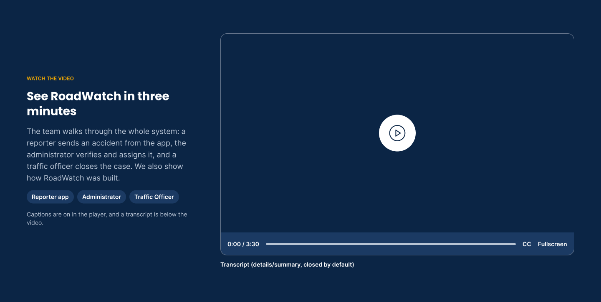
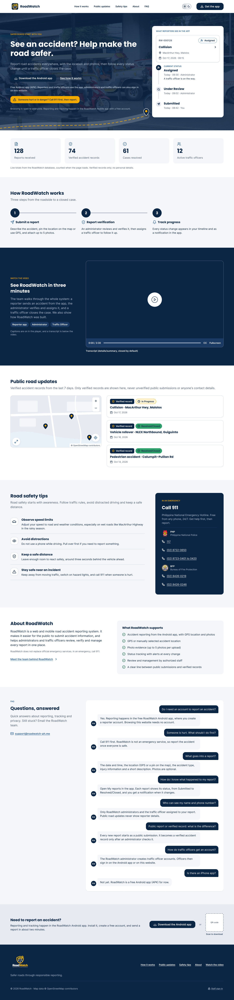
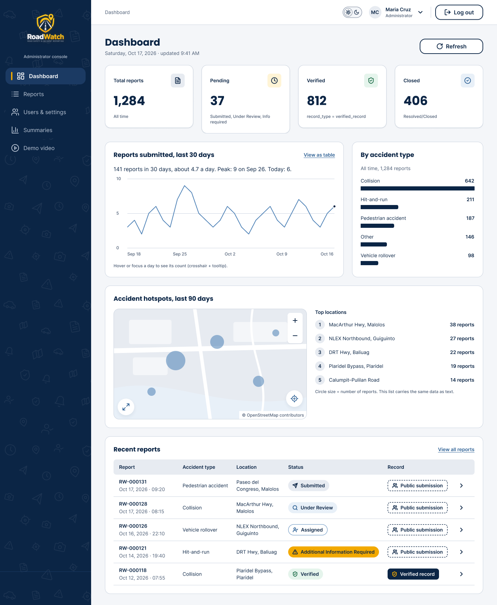
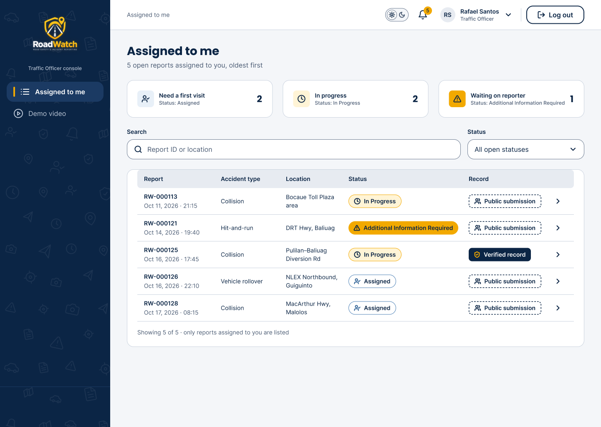
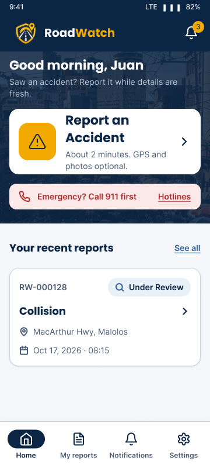
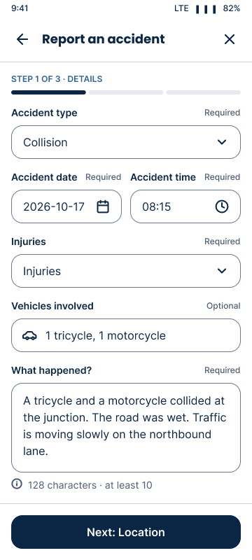
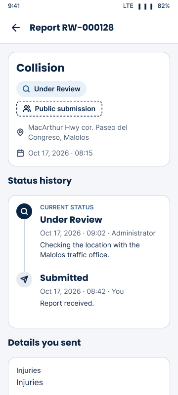
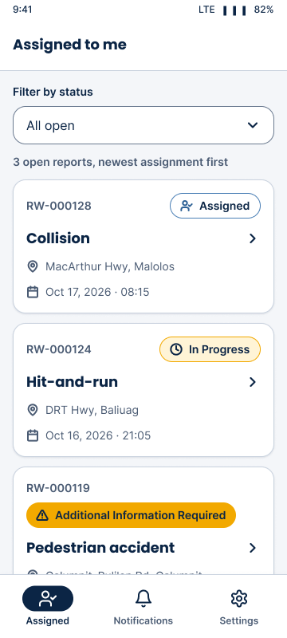
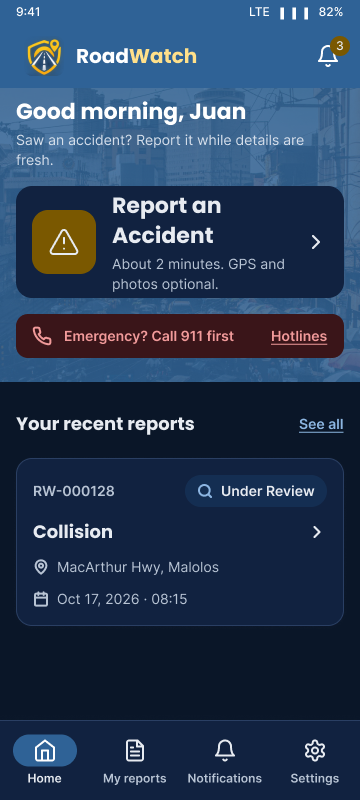
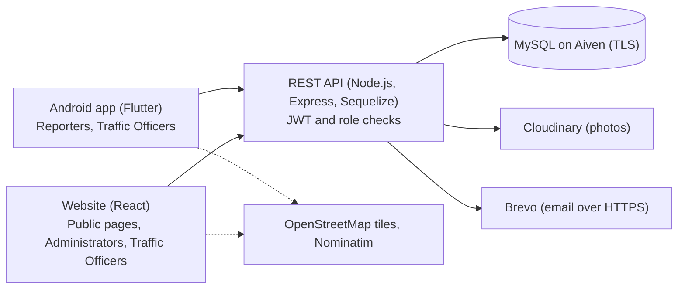

<p align="center">
  
</p>

<h1 align="center">RoadWatch</h1>

<p align="center"><b>Road accident reporting for the public, verified and closed by authorities.</b><br>
Report an accident from the Android app with its location and photos, then follow every status change until a traffic officer closes the case.</p>

<p align="center">
  <a href="https://github.com/l3n8n-ocd/roadwatch/actions/workflows/api-ci.yml"></a>
  <a href="https://github.com/l3n8n-ocd/roadwatch/actions/workflows/web-ci.yml"></a>
  <a href="https://github.com/l3n8n-ocd/roadwatch/actions/workflows/mobile-ci.yml"></a>
  <a href="https://github.com/l3n8n-ocd/roadwatch/releases/latest"></a>
  <a href="LICENSE"></a>
</p>

<p align="center">
  <a href="https://roadwatch-theta.vercel.app"><b>Website</b></a> ·
  <a href="https://github.com/l3n8n-ocd/roadwatch/releases/latest/download/roadwatch.apk"><b>Download the Android app (APK)</b></a> ·
  <a href="https://roadwatch-api-gnky.onrender.com/api/health">API status</a> ·
  <a href="docs/API.md">API reference</a>
</p>

> RoadWatch does not replace official emergency services. In an emergency, call 911.

## Watch the video

<a href="https://roadwatch-theta.vercel.app/#video"></a>

The promotional video (about 3 minutes) plays on the [website](https://roadwatch-theta.vercel.app/#video); the file is
`docs/video/roadwatch-promo.mp4`. Each app also has a 30-second demo clip for its roles (Settings > Demo video in the
Android app, Demo video in the staff website).

## Screenshots

| Public website | Administrator dashboard | Traffic Officer portal |
|---|---|---|
|  |  |  |

| App home | Report form | Report tracking | Officer: assigned | Dark mode |
|---|---|---|---|---|
|  |  |  |  |  |

More screens, light and dark, are in [`docs/ui-design/screens/`](docs/ui-design/screens/).

## Features

**Reporter** (Android app)
- Create an account and sign in; reset a forgotten password with an emailed code.
- Report an accident in three steps: details, location (GPS or a pin on the map) and up to 5 photos.
- Get a Report ID, follow each status change on a timeline, and get in-app and email notifications.

**Traffic Officer** (Android app or website)
- See the reports assigned to you, with the reporter's contact details, the map and the photos.
- Set In Progress, Additional Information Required or Resolved/Closed, and add official remarks.

**Administrator** (website)
- Dashboard with totals, trends, accident types and a hotspot map.
- Search and filter reports; review, verify or reject them (with a reason), then assign an officer.
- Manage accounts: create officers, change roles, deactivate or reactivate users, set temporary passwords.
- Daily, weekly, monthly and annual summaries with PDF and CSV export; an action log of every staff action.

**Everyone:** a public website with verified road updates from the last 7 days, safety tips and emergency hotlines; Light and Dark themes; designed for WCAG 2.1 AA.

Every report starts as a **public submission** and becomes a **verified accident record** only after an administrator checks it. Report status: Submitted, Under Review, Additional Information Required, Verified, Assigned, In Progress, Resolved/Closed or Rejected.

## Architecture



One REST API serves both apps. Photos go through the API to Cloudinary and only their links are stored. The API runs on Render, the website on Vercel, and the Android app is built by GitHub Actions on each release tag. More detail: [`docs/architecture/`](docs/architecture/) and [`docs/erd/`](docs/erd/).

## Built with

<table>
<tr><th align="left" colspan="7">Design</th></tr>
<tr><td align="center" width="104"><br><sub>Figma</sub></td></tr>
<tr><th align="left" colspan="7">Website</th></tr>
<tr><td align="center" width="104"><br><sub>React</sub></td><td align="center" width="104"><br><sub>Vite</sub></td><td align="center" width="104"><br><sub>Tailwind CSS</sub></td><td align="center" width="104"><br><sub>GSAP</sub></td><td align="center" width="104"><picture><source media="(prefers-color-scheme: dark)" srcset="docs/assets/logos/recharts-dark.png"></picture><br><sub>Recharts</sub></td><td align="center" width="104"><br><sub>Leaflet</sub></td></tr>
<tr><th align="left" colspan="7">Android app</th></tr>
<tr><td align="center" width="104"><br><sub>Flutter</sub></td><td align="center" width="104"><br><sub>Dart</sub></td><td align="center" width="104"><br><sub>flutter_map</sub></td></tr>
<tr><th align="left" colspan="7">API</th></tr>
<tr><td align="center" width="104"><br><sub>Node.js</sub></td><td align="center" width="104"><picture><source media="(prefers-color-scheme: dark)" srcset="docs/assets/logos/express-dark.svg"></picture><br><sub>Express</sub></td><td align="center" width="104"><br><sub>Sequelize</sub></td><td align="center" width="104"><br><sub>Zod</sub></td><td align="center" width="104"><picture><source media="(prefers-color-scheme: dark)" srcset="docs/assets/logos/jwt-dark.svg"></picture><br><sub>JWT</sub></td><td align="center" width="104"><picture><source media="(prefers-color-scheme: dark)" srcset="docs/assets/logos/pdfkit-dark.png"></picture><br><sub>PDFKit</sub></td><td align="center" width="104"><picture><source media="(prefers-color-scheme: dark)" srcset="docs/assets/logos/csv-dark.svg"></picture><br><sub>CSV export</sub></td></tr>
<tr><th align="left" colspan="7">Data and services</th></tr>
<tr><td align="center" width="104"><br><sub>MySQL</sub></td><td align="center" width="104"><picture><source media="(prefers-color-scheme: dark)" srcset="docs/assets/logos/aiven-dark.svg"></picture><br><sub>Aiven</sub></td><td align="center" width="104"><br><sub>Cloudinary</sub></td><td align="center" width="104"><br><sub>Brevo</sub></td><td align="center" width="104"><br><sub>OpenStreetMap</sub></td><td align="center" width="104"><br><sub>Nominatim</sub></td></tr>
<tr><th align="left" colspan="7">Hosting and delivery</th></tr>
<tr><td align="center" width="104"><picture><source media="(prefers-color-scheme: dark)" srcset="docs/assets/logos/vercel-dark.svg"></picture><br><sub>Vercel</sub></td><td align="center" width="104"><picture><source media="(prefers-color-scheme: dark)" srcset="docs/assets/logos/render-dark.svg"></picture><br><sub>Render</sub></td><td align="center" width="104"><picture><source media="(prefers-color-scheme: dark)" srcset="docs/assets/logos/github-dark.svg"></picture><br><sub>GitHub</sub></td><td align="center" width="104"><br><sub>GitHub Actions</sub></td><td align="center" width="104"><br><sub>Git</sub></td><td align="center" width="104"><br><sub>Namecheap</sub></td></tr>
</table>

## Repository structure

| Folder | Contents |
|---|---|
| [`api/`](api/) | Express REST API, Sequelize models, tests |
| [`web/`](web/) | React + Vite + Tailwind website (public pages, Administrator and Traffic Officer consoles) |
| [`mobile/`](mobile/) | Flutter Android app (Reporter and Traffic Officer) |
| [`database/`](database/) | `schema.sql`, `seed.sql`, `local-init.sql` |
| [`docs/`](docs/) | API reference, decisions log, ERD, architecture, UI design exports, test plans, user guide |
| [`scripts/`](scripts/) | Repository helper scripts |
| `.github/workflows/` | `api-ci`, `web-ci`, `mobile-ci` |
| `render.yaml` | Render Blueprint for the API |

## Getting started

**Requirements:** Node.js 22.23.4 or newer, MySQL 8 (or MariaDB for local work), Flutter (stable) with the Android SDK, Git.

1. **Database.** Create a database, then run `database/schema.sql` and `database/seed.sql` against it (`database/local-init.sql` creates a local `roadwatch` database). Both files are safe to re-run.
2. **API.**
   ```bash
   cd api
   cp .env.example .env     # fill in your own values; never commit .env
   npm install
   npm run check:db         # connects and checks the tables
   npm run seed:admin       # creates the first Administrator (ADMIN_PASSWORD must be Strong)
   npm run dev              # http://localhost:5000/api/health
   ```
   Environment variables (names only): `PORT`, `CLIENT_ORIGIN`, `DB_HOST`, `DB_PORT`, `DB_USER`, `DB_PASSWORD`, `DB_NAME`, `DB_SSL`, `DB_SSL_CA` or `DB_SSL_CA_PATH`, `JWT_SECRET`, `JWT_EXPIRES_IN`, `ADMIN_NAME`, `ADMIN_EMAIL`, `ADMIN_PASSWORD`, `CLOUDINARY_URL`, `MAIL_PROVIDER` (`brevo`, or `log` for local work), `MAIL_FROM`, `BREVO_API_KEY`, `PROMO_VIDEO_URL`, `DEMO_VIDEO_REPORTER_URL`, `DEMO_VIDEO_OFFICER_URL`, `DEMO_VIDEO_ADMIN_URL`.
3. **Website.**
   ```bash
   cd web
   npm install
   VITE_API_URL=http://localhost:5000/api npm run dev
   ```
4. **Android app.**
   ```bash
   cd mobile
   flutter pub get
   flutter run --dart-define=API_URL=http://10.0.2.2:5000/api   # Android emulator to the local API
   ```

Step-by-step setup, including Aiven and Render: [`docs/SETUP-GUIDE.md`](docs/SETUP-GUIDE.md).

## Testing

| Part | Command | Notes |
|---|---|---|
| API | `cd api && npm test` | Unit tests always; the database flow runs with `RUN_DB_TESTS=true` against a local database only |
| Website | `cd web && npm run lint && npm run build` | |
| Android app | `cd mobile && flutter analyze && flutter test` | Widget tests with a fake API |

CI runs the same checks on pull requests and on pushes to `dev` and `main`. The manual test plan (one case per requirement, plus accessibility checks) is in [`docs/test-plan.md`](docs/test-plan.md).

## Deployment

- **API:** Render web service from the `render.yaml` Blueprint (`rootDir: api`, Node 22.23.4, health check `/api/health`), deployed from `main`. The free plan sleeps when idle, so the first request after a pause is slow.
- **Website:** Vercel, root folder `web`, `VITE_API_URL` set to the API, deployed from `main`.
- **Android app:** pushing a `v*` tag that matches the version in `mobile/pubspec.yaml` makes `mobile-ci` build the release APK and attach `roadwatch.apk` to a GitHub Release.

## Security

- Passwords are hashed with bcrypt; new passwords must be Strong (the same rules run in the API, the website and the app).
- JWT sign-in with role checks on every protected endpoint; the user is re-loaded on each request, so deactivation takes effect at once.
- Platform rule: Reporters sign in on the app, Administrators on the website, Traffic Officers on either.
- Input validation with Zod, Helmet and CORS, rate limiting, and upload limits on type and size.
- Reporter contact details are shown only to administrators and the officer assigned to the report; the public updates never include them.
- Important staff actions and every status change are written to an audit log.

## Roadmap

- Google Play Store release, with a QR code on the website ([#51](https://github.com/l3n8n-ocd/roadwatch/issues/51)).
- Custom domain `roadwatch-ph.me` for the website and the API.

## Team

<table>
<tr><td align="center" width="200"><br><b>Lenon Adriano</b><br><sub>Project Lead & Mobile</sub></td><td align="center" width="200"><br><b>Pauline Lapuz</b><br><sub>Web & QA</sub></td><td align="center" width="200"><br><b>Carl Ernest Santos</b><br><sub>Backend & Database</sub></td><td align="center" width="200"><br><b>Princess Lorellyn Isip</b><br><sub>Documentation</sub></td></tr>
</table>

- **Lenon Adriano** (Project Lead & Mobile): Leads the project and builds the Android app in Flutter; keeps the repository, CI and releases running.
- **Pauline Lapuz** (Web & QA): Builds the administrator web dashboard in React and runs the test plan for both apps, including accessibility checks.
- **Carl Ernest Santos** (Backend & Database): Designs the MySQL database and builds the Express API, from sign-in and reports to exports and email.
- **Princess Lorellyn Isip** (Documentation): Writes the user guide and project documents, and produces the demo video.

Map data © [OpenStreetMap](https://www.openstreetmap.org/copyright) contributors. Icons: Lucide (ISC). Fonts: Poppins and Inter (SIL Open Font License).

## License

Copyright © 2026 the RoadWatch team. All rights reserved. See [LICENSE](LICENSE).
